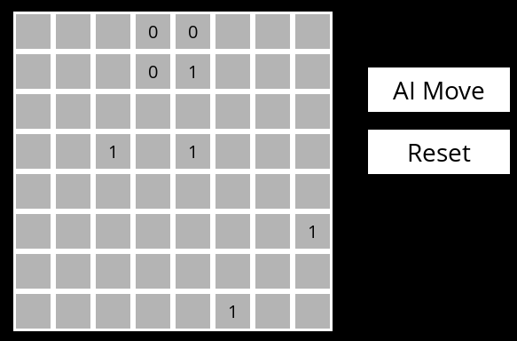

# Démineur avec un agent basé sur la connaissance

Jeu de Démineur sur une grille de 8 × 8, où le joueur peut révéler les cases ou demander à un agent de jouer. L'agent utilise une base de connaissances et des règles d'inférence logique pour identifier les cases sûres et les mines.

## Interface du runner



## Fonctionnalités

- Plateau de **8 × 8 cases** contenant **8 mines**.
- Révélation manuelle des cases et signalement des mines avec des drapeaux.
- Coups proposés par l'agent à partir des informations révélées.
- Détection de victoire ou de défaite.
- Possibilité de recommencer une partie avec un nouveau plateau.

## Comment jouer

1. Lancez le jeu et cliquez sur **Play Game**.
2. Cliquez sur une case pour la révéler.
3. Faites un clic droit sur une case non révélée pour ajouter ou retirer un drapeau.
4. Cliquez sur **AI Move** pour demander à l'agent de jouer.
5. Cliquez sur **Reset** pour commencer une nouvelle partie.

La partie est gagnée lorsque les drapeaux placés correspondent exactement à toutes les mines. Révéler une mine met fin à la partie et affiche les mines du plateau.

## Algorithme de l'IA

Chaque nombre révélé indique combien de mines se trouvent parmi les cases voisines. L'agent transforme cette information en phrase logique, puis la conserve dans sa base de connaissances. Il marque les cases sûres et les mines lorsqu'il peut les déduire, et compare ses phrases pour obtenir de nouvelles conclusions.

Lorsqu'on lui demande un coup, l'agent choisit d'abord une case qu'il sait sûre. S'il n'en connaît aucune, il sélectionne au hasard une case non jouée qu'il ne sait pas être une mine. Ce choix peut être une mine : l'agent ne garantit donc pas une victoire.

## Installation et lancement

```bash
git clone https://github.com/cestbryan-ng/KBA-Minesweeper.git
cd KBA-Minesweeper
python -m pip install -r requirements.txt
python runner.py
```
